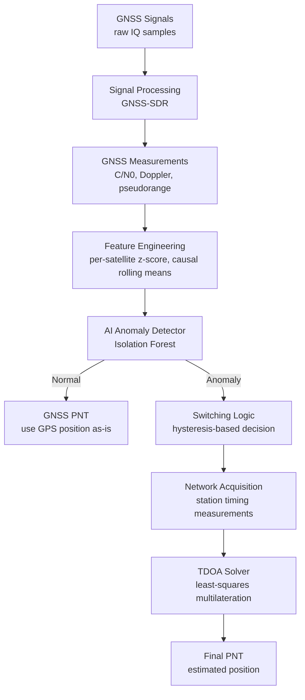

# AI-Network-PNT-Assistant


An AI-based system for detecting GPS spoofing attacks and falling back to network-based
Positioning, Navigation & Timing (PNT) when GPS readings are compromised.

---

## Table of Contents

- [Overview](#overview)
- [Project Status](#project-status)
- [System Architecture](#system-architecture)
- [Dataset](#dataset)
- [Detection Model (current: v2)](#detection-model-current-v2)
- [Evaluation Protocol](#evaluation-protocol)
- [Version History](#version-history)
- [Results](#results)
- [Known Limitations](#known-limitations)
- [Project Structure](#project-structure)
- [Getting Started](#getting-started)
- [Testing](#testing)
- [References](#references)
- [License](#license)

---

## Overview

GPS spoofing is an attack in which a malicious actor broadcasts counterfeit GPS signals to
deceive a receiver into computing a false position, velocity, or time. This project addresses
that threat with a three-stage pipeline:

1. **Detection** - an unsupervised anomaly detection model continuously evaluates incoming
   GPS observables (per-satellite signal strength, C/N0) and flags readings that deviate from
   learned normal behavior.
2. **Switching Logic** - a hysteresis-based decision engine determines whether to trust GPS
   or fall back to an alternative positioning source, avoiding rapid flip-flopping on
   borderline detections.
3. **PNT Engine** - classical multilateration mathematics (TDOA / trilateration, optionally
   smoothed with a Kalman filter) computes position from network-based timing measurements
   when GPS is deemed unreliable.

The system is designed so that each stage can be developed, tested, and validated
independently of physical hardware, using recorded reference data as a stand-in until a
physical station (PC + USRP) becomes available.

---

## Project Status

| Component | Status |
|---|---|
| **v1 detector** (5 features, Isolation Forest) | Kept unchanged as the reference baseline. Its originally reported numbers were found to be inflated by the evaluation setup; see [v1 details](docs/versions/v1.md). |
| **v2 detector** (smoothed per-satellite C/N0 z-score, Isolation Forest) | Designed, evaluated without leakage, and frozen. Artifacts are stored in `models/v2/`. See [v2 details](docs/versions/v2.md). |
| **v3** (additional signals, epoch-level decision, confidence score, uncertainty, other receivers) | Experiments in progress in `notebooks/03_v3_improvements.ipynb`. Nothing from v3 is part of the detector yet. |
| Network PNT (TDOA / trilateration / Kalman) | Unchanged. Validated on synthetic data and a mock station source. |

---

## System Architecture

### High-level data flow

```
                    GNSS Signals
                         |
                         v
                 Signal Processing
                         |
                         v
                GNSS Measurements
                         |
                         v
                Feature Engineering
                         |
                         v
                AI Anomaly Detector
                         |
                   +-----+-----+
                   |           |
                Normal       Anomaly
                   |           |
                   v           v
              GNSS PNT    Switching Logic
                               |
                               v
                         Network PNT
                               |
                               v
                         TDOA Solver
                               |
                               v
                          Final PNT
```

### Detailed pipeline (module-level)



### Planned multi-source architecture

The next architectural step is to compare several PNT sources and weight them by quality
instead of switching between two. The detector's role there is to produce a GPS quality value,
not only a flag (see the confidence-score experiment in v3).

```
              GNSS/GPS --> AI Spoofing Detector --> GPS position + quality
                                                          |
        +-------------------------+-----------------------+
        |                         |                       |
       GPS PNT                  5G PNT             Ground / Network PNT
        |                         |                       |
        +-------------------------+-----------------------+
                                  |
                       Source evaluation (quality / confidence)
                                  |
                       Source selection / weighting
                                  |
                       Multi-source fusion (Kalman)
                                  |
                              Final PNT
```

**Design principle:** every stage that depends on hardware not yet available (USRP, physical
network stations) is implemented behind a factory interface (`source_factory.py`,
`station_source_factory.py`) with a working mock/file-based implementation today and a
documented placeholder for the real one. Switching to real hardware later requires a
one-line config change, not a code rewrite.

### Module to pipeline stage mapping

| Pipeline stage | Source code |
|---|---|
| GNSS Signals | `src/signal_acquisition/` (`file_source.py` today, `usrp_source.py` pending hardware) |
| Signal Processing | `src/gnss_processing/` (`observable_parser.py`, GNSS-SDR integration) |
| GNSS Measurements | Raw `channel`/`navsol` observables (C/N0, Doppler, pseudorange, carrier phase, TXID) |
| Feature Engineering | `src/feature_engineering/` (v1: `satellite_baseline.py`, `rolling_features.py`, `feature_pipeline.py`; v2: `zscore_features.py`) |
| AI Anomaly Detector | `src/detection_model/` (`model.py`, `train.py`, `predict.py`) |
| Switching Logic | `src/switching_logic/decision_engine.py` |
| Network PNT / TDOA Solver | `src/network_acquisition/` + `src/pnt_engine/` (`tdoa.py`, `trilateration.py`, `kalman_filter.py`) |
| Final PNT | Output of `main.py`'s end-to-end loop |

---

## Dataset

The detection model is trained and evaluated on **TEXBAT** (Texas Spoofing Test Battery), a
publicly available dataset from the University of Texas at Austin Radionavigation Laboratory.
Unlike purely simulated datasets, TEXBAT combines a genuine recorded GPS signal with realistic
spoofing signals generated using real spoofing hardware, making it substantially more
representative of real-world conditions.

Four scenarios are used (14 tracked satellites, 5 Hz):

| Scenario | Description | Attack onset | Role in v2 |
|---|---|---|---|
| `cleanStatic` | No attack, static receiver (~430 s) | N/A (fully clean) | Baseline and model fitting (normal only) |
| `ds2` | Abrupt time-push attack | Second 477992 (C/N0 jump analysis, agreement across satellites) | Development |
| `ds3` | Gradual takeover (slow C/N0 decline during the ramp, abrupt jump at the takeover) | Second 478001 (C/N0 slope + jump analysis) | Development |
| `ds7` | Power-matched, phase-aligned attack (hardest to detect) | Second 478036 (official TEXBAT documentation; not verifiable from the data itself) | Final test, already evaluated twice (rule and Isolation Forest) |

Ground truth for ds2/ds3 was established through direct visual and statistical analysis of
C/N0 and Doppler shift, rather than relying on the receiver's own spoofing flag, which failed
on every attack scenario tested. Labels are time-based (`label = 1` from the onset second for
all satellites).

> **Caveat:** because the ds2/ds3 onsets were derived from the C/N0 signal, and C/N0 is also the
> main detection feature, label and detector are not fully independent. The ds7 onset comes from
> documentation and the signal itself shows little change, so its labels cannot be checked.

---

## Detection Model (current: v2)

**Approach:** unsupervised anomaly detection (Isolation Forest) fitted exclusively on normal
readings, plus a per-satellite baseline of what "normal" C/N0 looks like.

**Features (three, all derived from one quantity):**

| Feature | Meaning |
|---|---|
| `z_roll_mean_5` | Causal rolling mean (5 samples, 1 s) of the per-satellite C/N0 z-score |
| `z_roll_mean_25` | Same over 25 samples (5 s) |
| `z_roll_mean_50` | Same over 50 samples (10 s) |

The z-score measures how far a satellite's C/N0 is from that satellite's own normal level:
`z = (cn0 - mean_sat) / max(std_sat, 0.5 dB)`. The baseline (mean, std per satellite) is computed
from the clean `cleanStatic` recording only.

**Threshold:** calibrated to a 5% false-positive rate on the pooled *normal* rows of ds2 and ds3
(scenarios that are not used to fit the model). A tested scenario is never used to calibrate its
own threshold.

**Reference model:** a one-line rule, `|rolling mean of z (25 samples)| > 1.79`, is kept next to the
Isolation Forest to show what the model adds. The two perform within noise of each other, which
means the quality of the feature, not the complexity of the model, drives the result.

Full design decisions and the evidence behind each one: [v2 details](docs/versions/v2.md).

---

## Evaluation Protocol

The original evaluation (v1) used a random row split and chose thresholds and features by looking
at test results. All numbers in the current results use this protocol instead:

1. The baseline and the model are fitted on **normal rows only**.
2. A tested scenario is **never** part of the fitting data (leave-one-scenario-out).
3. The alarm threshold is calibrated on the normal rows of a **different** scenario.
4. Threshold-free metrics are reported (AUC, recall at fixed false-positive rate) in addition to
   the calibrated operating point.
5. The final test scenario is evaluated **once**, after the model is frozen.

---

## Version History

| Version | Summary | Details |
|---|---|---|
| **v1** | Five features (C/N0 z-score, rolling std and difference of C/N0 and Doppler), Isolation Forest, percentile-20 threshold. Reported recall 0.91 / precision 0.94 on a random-split test. | [docs/versions/v1.md](docs/versions/v1.md) |
| **v2** | Re-evaluated v1 without leakage, found the extra features hurt, reduced the model to a smoothed per-satellite C/N0 z-score, calibrated the threshold honestly, froze the model, tested once on ds7. | [docs/versions/v2.md](docs/versions/v2.md) |
| **v3** (in progress) | Pseudorange / carrier-phase consistency signals, epoch-level decision with detection delay and false alarm events, calibrated GPS quality score, bootstrap error bars, self-calibration for other receivers. | `notebooks/03_v3_improvements.ipynb` |

**Key lessons so far**

- The biggest gain came from correctly defining "normal" per satellite, not from a more complex model.
- Reported performance depends heavily on how the evaluation is built; a random split of 5 Hz data and
  threshold tuning on the test set made v1 look much better than it was.
- Removing four of the five v1 features improved results: weak features can hurt an Isolation Forest.

---

## Results

### Same leakage-free protocol, v1 features vs v2 (development scenarios)

Model trained without the tested scenario, threshold-free AUC and recall at about 5% false-positive rate.

| Scenario | v1 (5 features) AUC | v1 recall at 5% FPR | v2 AUC | v2 recall (actual FPR) |
|---|---|---|---|---|
| ds2 | 0.898 | 0.31 | 0.986 | 0.988 (5.3%) |
| ds3 | 0.840 | 0.23 | 0.916 | 0.690 (4.4%) |

The v1 recall is read off the ROC curve at exactly 5% FPR; the v2 recall is measured at the
calibrated threshold, whose actual false-positive rate is shown in brackets. ds2 and ds3 influenced
design choices, so these are **development results**.

### Final test on ds7 (frozen models, evaluated once)

| Model | AUC | False-positive rate | Recall |
|---|---|---|---|
| v2 Isolation Forest | 0.669 | 3.3% | 14.4% |
| v2 simple rule | 0.671 | 3.7% | 18.5% |
| v1 features (5th-percentile threshold from training data, for reference) | 0.705 | 8.2% | 16.2% |

ds7 is a power-matched attack. The detector reacts at the documented onset (the flag rate jumps in the
first seconds) but detection is weak and irregular afterwards. This is a known limit of C/N0-only detection.

### What the original v1 numbers were

The original README reported recall 0.91 and precision 0.94 on ds2+ds3 and recall 0.58 on ds7. Those
numbers came from a random 70/30 row split of the normal data, with the threshold and the feature set
chosen by looking at the same test set, and precision computed on a test set that was 78.6% attack.
They should not be used as performance claims. Explanation and evidence: [v1 details](docs/versions/v1.md).

### End-to-end pipeline validation (v1 code path)

The full pipeline (signal source, features, detection, switching, PNT calculation) was run against a
labeled TEXBAT file (`ds2`) through `main.py`, and the switching logic triggered network-based position
calculation during the labeled attack period. ds2 is a scenario whose normal part is used to fit the
model, so this validates the mechanics of the pipeline, not its generalization. The TDOA position
solver was independently verified with a synthetic test recovering a known position to 0.0 m error.

---

## Known Limitations

1. **ds7-type attacks are only weakly detectable** with C/N0-based features. Detecting them needs
   other signals (the v3 experiments test pseudorange / carrier-phase consistency) or an independent
   position source, which is the motivation for the multi-source architecture.

2. **Single receiver, single site, static scenarios, three attack recordings.** The per-satellite
   baseline is tied to the receiver (and to the satellite geometry at the time of recording). Results
   do not say anything about other receivers or dynamic scenarios.

3. **Calibration gap between TEXBAT's reference receiver and GNSS-SDR.** When the v1 model was applied
   to observables extracted via GNSS-SDR from a short (~5 s) raw IQ snippet of the `cleanStatic`
   recording, it produced a 100% false-positive rate:
   - Only 8 of 14 training-set satellites were acquired in the short snippet.
   - C/N0 offsets relative to the training baseline varied substantially and non-uniformly across
     satellites (z-score -0.5 to -3.7 for most satellites; -16.3 for one weak-signal satellite),
     consistent with known differences in tracking-loop performance between a professional hardware
     receiver and a software-defined receiver.
   - Whether v2 fixes this is **not yet shown**. A self-calibration test (baseline from the first
     seconds of the same recording) is part of the v3 experiments. Self-calibration assumes the start
     of the recording is clean, so an attacker present at start-up would poison the baseline.

4. **Evaluation limits.** ds2 and ds3 influenced the v2 design choices; ds7 has been used as a test twice
   (rule and Isolation Forest). Neighbouring samples are strongly correlated and no confidence intervals
   are reported yet (block bootstrap planned in v3). Statements about 1% false-positive rate are not
   reliable with the amount of normal data available (about 10 minutes in total).

5. **Detection is per satellite row, not per epoch.** Detection delay (seconds until the alarm) and the
   number of false alarm *events* per hour have not been measured yet. The current switching logic
   takes a majority vote over consecutive rows, which can come from different satellites rather than
   from consecutive moments in time.

6. **Network-based PNT is validated mathematically but not against real station data.**
   `tdoa.py` was verified against a synthetic ground-truth position (0.0 m error) and is exercised
   end-to-end via a mock station source. It has not yet been tested against real multi-station timing
   measurements, and it assumes the stations share a common time reference.

7. **No real-time streaming or hardware integration yet.** The pipeline runs in batch/offline mode
   against recorded files. `usrp_source.py` and `real_station_source.py` are documented placeholders
   pending physical hardware.

---

## Project Structure

```
AI-Network-PNT-Assistant/
|-- .github/
|   `-- workflows/
|       `-- ci.yml
|
|-- configs/
|   |-- config.yaml                  # main configuration (signal source, model, switching, PNT)
|   `-- usrp_config.yaml             # USRP hardware settings (placeholder until hardware available)
|
|-- data/                            # recorded/reference data and GNSS-SDR outputs
|
|-- docs/
|   `-- versions/
|       |-- v1.md                    # original baseline: design, reported results, re-evaluation
|       `-- v2.md                    # current detector: design decisions, evidence, frozen artifacts
|
|-- models/                          # trained model artifacts
|   |-- detector.pkl                 # v1 (reference baseline, do not overwrite)
|   |-- scaler.pkl
|   |-- threshold.txt
|   |-- satellite_baselines.csv
|   `-- v2/                          # v2 frozen artifacts
|       |-- detector_v2.pkl
|       |-- scaler_v2.pkl
|       |-- threshold_v2.txt
|       |-- baseline_v2_cn0_floored.csv
|       `-- if_v2_config.json
|
|-- notebooks/
|   |-- Network_PNT.ipynb            # v1 development history
|   |-- Network_v2.ipynb             # v2: leakage-free re-evaluation, experiments, frozen model, final test
|   `-- 03_v3_improvements.ipynb     # v3 experiments (work in progress)
|
|-- src/
|   |-- signal_acquisition/          # GPS signal source (file-based today, USRP later)
|   |   |-- file_source.py
|   |   |-- usrp_source.py           # placeholder - requires physical hardware
|   |   `-- source_factory.py
|   |
|   |-- network_acquisition/         # network station timing source (mock today, real later)
|   |   |-- mock_station_source.py
|   |   |-- real_station_source.py   # placeholder - requires physical stations
|   |   `-- station_source_factory.py
|   |
|   |-- gnss_processing/             # raw IQ -> observables (GNSS-SDR integration)
|   |   |-- gnss_sdr_config/
|   |   |   `-- default.conf         # GNSS-SDR configuration used for raw signal testing
|   |   |-- gnss_sdr_runner.py       # placeholder - GNSS-SDR currently run manually via CLI
|   |   |-- observable_parser.py     # parses GNSS-SDR tracking output into model-ready schema
|   |   `-- run_pipeline.py          # glue script: parser -> feature_pipeline -> feature matrix
|   |
|   |-- feature_engineering/
|   |   |-- satellite_baseline.py    # v1: per-satellite baseline computation/loading
|   |   |-- rolling_features.py      # v1: rolling std, rate of change
|   |   |-- feature_pipeline.py      # v1: feature construction
|   |   `-- zscore_features.py       # v2: z-score + causal rolling means (batch and streaming, same numbers)
|   |
|   |-- detection_model/
|   |   |-- model.py                 # GPSAnomalyDetector (Isolation Forest + calibrated threshold), used by v1 and v2
|   |   |-- train.py                 # v1 training
|   |   `-- predict.py
|   |
|   |-- switching_logic/
|   |   `-- decision_engine.py       # hysteresis-based GPS/network decision
|   |
|   `-- pnt_engine/
|       |-- tdoa.py                  # verified against synthetic ground truth (0.0 m error)
|       |-- trilateration.py
|       `-- kalman_filter.py
|
|-- tests/
|-- LICENSE
|-- main.py
|-- README.md
`-- requirements.txt
```

> Files marked **v2** and the `models/v2/` folder are added when the v2 detector is integrated into the
> repository. Keep the v1 files untouched so both versions can be compared.

---

## Getting Started

```bash
# 1. Install dependencies
pip install -r requirements.txt

# 2. (v1) Train the original detection model (uses cleanStatic + ds2 + ds3; ds7 excluded by design)
python -m src.detection_model.train --data data/combined_labeled.csv

# 3. Run the full pipeline against a recorded file
python main.py
```

Configuration (signal source, model directory, switching sensitivity, PNT method) is
controlled entirely through `configs/config.yaml` - no code changes are needed to point the
pipeline at a different input file or adjust the switching hysteresis window.

**v2:** the frozen v2 artifacts are produced in `notebooks/Network_v2.ipynb` (freeze section) and stored in
`models/v2/`. The detector version is meant to be selected in the configuration:

```yaml
detection_model:
  version: "v2"   # "v1" = original baseline, "v2" = smoothed z-score Isolation Forest
```

The v2 features keep a rolling state per satellite, so processing a stream in chunks gives the same numbers
as processing the whole file (this was not the case for the v1 feature code, which restarted the rolling
windows for every chunk). A training script for v2 (`train_v2.py`) is planned; until then the notebook is the
reference for how the artifacts are produced.

---

## Testing

```bash
# Unit test: switching logic behavior in isolation
python -m tests.test_switching_logic

# Unit test: TDOA math correctness against a known synthetic position
python -m tests.test_network_acquisition

# Integration sanity check: reproduce notebook-reported metrics on the combined dataset
python -m tests.test_with_recorded_file

# Integration check: scenario-specific reproduction of notebook's ds2 result (recall = 1.00)
python -m tests.test_full_pipeline_on_texbat

# v2: batch and streaming features must give identical numbers
pytest tests/test_zscore_parity.py
```

> **Note on the integration tests:** `test_with_recorded_file.py` and `test_full_pipeline_on_texbat.py`
> check that the pipeline reproduces the v1 notebook numbers. They evaluate the model on data that is
> (partly) part of its training data, or on a random split of it, so they verify pipeline mechanics
> only. They are **not** a measurement of generalization. For generalization, use the leave-one-scenario-out
> results in `notebooks/Network_v2.ipynb`.

---

## References

- Humphreys, T. E. et al. - TEXBAT: Texas Spoofing Test Battery, University of Texas at
  Austin Radionavigation Laboratory
- GNSS-SDR - open-source GNSS software-defined receiver, [gnss-sdr.org](https://gnss-sdr.org)
- scikit-learn IsolationForest documentation

---

## License

This project's source code is licensed under the MIT License (see [LICENSE](LICENSE)).

Note: the TEXBAT dataset used for training/evaluation is subject to its own usage terms
from the University of Texas at Austin Radionavigation Laboratory, and is not included
in this repository. Refer to the [official TEXBAT page](https://radionavlab.ae.utexas.edu/texbat/)
for access and usage conditions.